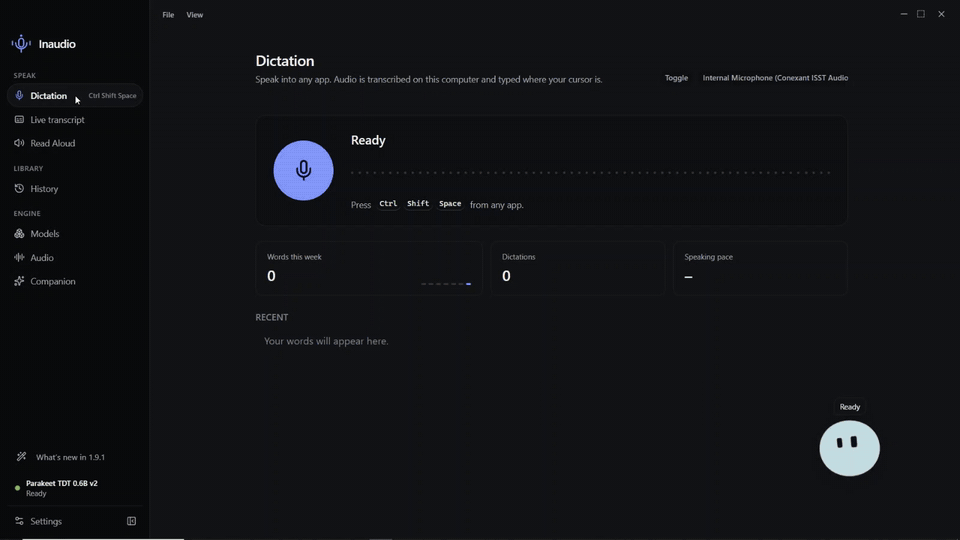

<p align="center">
  
</p>
<h1 align="center">Inaudio</h1>
<p align="center">Read aloud, on your machine.</p>
<p align="center">
  Offline read-aloud for the desktop.<br />
  Built with Electron, React, TypeScript, and sherpa-onnx.
</p>
<p align="center">
  <a href="https://github.com/shikki841/inaudio/actions/workflows/ci.yml"></a>
  <a href="LICENSE"></a>
  <a href="https://github.com/shikki841/inaudio/releases"></a>
</p>
<p align="center">
  <a href="https://github.com/shikki841/inaudio/releases">Downloads</a> ·
  <a href="CONTRIBUTING.md">Contribute</a> ·
  <a href="https://github.com/shikki841/inaudio/issues/new/choose">Report an issue</a>
</p>

## See it work

<p align="center">
  <a href="https://github.com/shikki841/inaudio/releases/download/v1.10.0/inaudio-demo.mp4">
    
  </a>
</p>
<p align="center">
  <a href="https://github.com/shikki841/inaudio/releases/download/v1.10.0/inaudio-demo.mp4">Watch the full recording with sound</a> (about 4 minutes, recorded on Windows from a real run).
</p>

## Read it back, keep going.

- Read selected or typed text aloud with a local Kokoro voice.
- Change speed up to 3×, follow along sentence by sentence, or use speed-reading (one word at a time).
- A sentence buffer generates a few lines ahead so playback does not stall.
- Manage the voice, shortcuts, companion, and updates in one desktop app.

Download the voice once, then run inference locally. Model downloads need an internet connection. Desktop packages target Windows (x64) and macOS (arm64). Releases are distributed through electron-builder update manifests; CI artifacts are currently unsigned and development builds do not contact the update feed.

## Run locally

Use Node.js 24 LTS and npm. Native packaging prerequisites are in [CONTRIBUTING.md](CONTRIBUTING.md).

```sh
git clone https://github.com/shikki841/inaudio.git
cd inaudio
npm ci
npm start
```

```sh
npm run check   # TypeScript + ESLint
npm run package:release  # Build the electron-builder package for your current OS
```

Pick the Kokoro voice during setup.

## Self-host in a browser

A Node server and a small website reuse the same sherpa-onnx voice. Family members can open it in Safari or Chrome — no install, no terminal on their computer.

```sh
docker compose up --build
```

Open [http://localhost:8080](http://localhost:8080) on the host. The first start downloads the Kokoro voice. See [docs/self-hosting.md](docs/self-hosting.md).

```sh
npm run web   # without Docker: build the site and serve it
```

## Build with us

Small fixes, platform testing, and clear bug reports help. Read the [contribution guide](CONTRIBUTING.md), [community guidelines](CODE_OF_CONDUCT.md), and [release process](.github/RELEASING.md). Report vulnerabilities through the [security policy](SECURITY.md).
